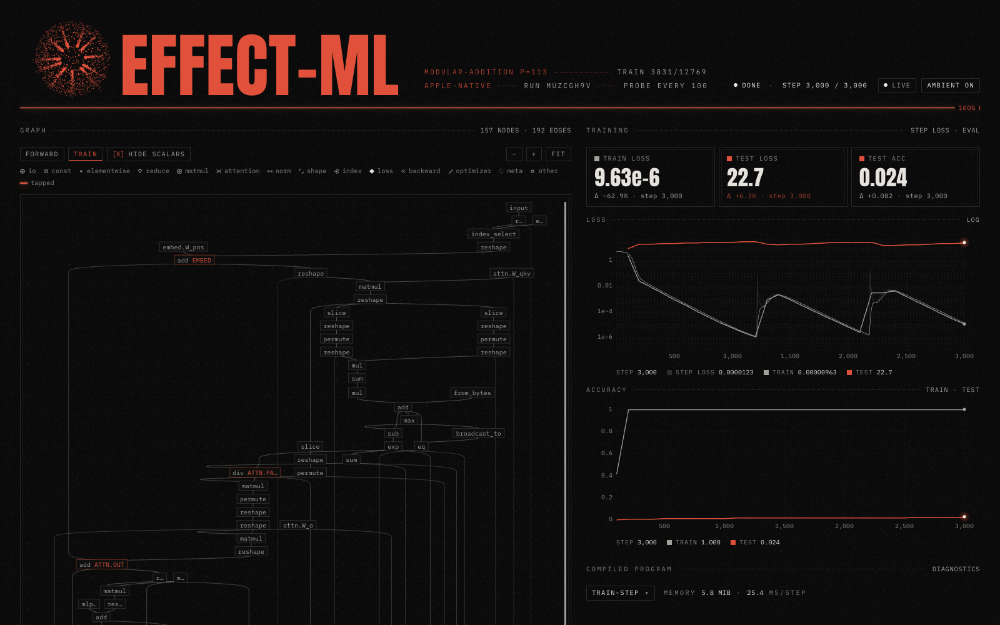

# effect-ml

Live training viewer for [effect-torch](https://github.com/Mark-Life/effect-torch).
The demo trains a small transformer on modular addition on Apple Metal and
streams the graph, compile diagnostics, loss, accuracy, heatmaps, and
histograms to a browser page.



## Setup

effect-ml uses a local effect-torch checkout through `bun link`. Build the
Metal addon in release mode first. A debug addon makes each step several times
slower.

```sh
cd ../../open-source/effect-torch/packages/backend-apple-native
node ../../scripts/build-native.mjs --host --profile release
pnpm run build:ts

cd ~/Code/personal/effect-ml
bun install
```

## Run

```sh
DEMO_STEPS=20000 DEMO_PROBE_EVERY=100 bun run start
```

Open http://localhost:4173. A page opened mid-run receives the full history.
Ctrl-C stops the server.

| Variable | Default | Meaning |
|---|---|---|
| `DEMO_STEPS` | `20000` | Training steps |
| `DEMO_PROBE_EVERY` | `100` | Steps between probes (eval, heatmaps, histograms). `0` trains in one call without probes |
| `DEMO_P` | `113` | Modulus of the addition task |
| `DEMO_TRAIN_FRAC` | `0.3` | Fraction of all `(a, b)` pairs used for training |
| `DEMO_LR` | `0.001` | AdamW learning rate |
| `DEMO_WEIGHT_DECAY` | `1` | AdamW weight decay |
| `DEMO_HOLD` | `true` | Keep the server up after training ends or fails |
| `VIEWER_PORT` | `4173` | HTTP and WebSocket port |
| `VIEWER_DEV` | `false` | Bun development mode (HMR for the page). `bun run dev` sets it |

On M1 Max a step takes about 23 ms, and a probe about 115 ms. A 20k-step run
takes about 9 minutes and groks near step 8000.

## Viewer without training

`bun run viewer:fixture` serves synthetic data and a saved graph from
`src/web/fixtures/`. Use it to work on the page without the addon. It reads
`FIXTURE_STEPS`, `FIXTURE_PROBE_EVERY`, and `FIXTURE_STEPS_PER_TICK`.

## Viewer controls

| Input | Action |
|---|---|
| Wheel, drag | Scroll and pan the graph. The page scrolls on at the graph edge |
| Ctrl or Cmd + wheel, pinch, `−` `+` | Zoom the graph. Zoomed out, boxes become small labelled chips, then dots; hover one for its full details |
| `FIT` | Fit the graph width, never below the chip scale; a tall graph starts at the top and scrolls |
| Click a node, `Esc` | Select it and light its ancestors and descendants; clear |
| `a`, `AMBIENT` chip | Turn grain, particle sphere and graph pulses on or off |
| `PIXELS / DOTS` | Exact heatmap pixels or halftone dots (histograms follow) |
| Hover a heatmap or histogram | Read the cell value or the bin range and count |
| Click the signature | Copy it |

## Checks

```sh
bun run typecheck
bun test src
```

The page needs WebGPU for heatmaps.
